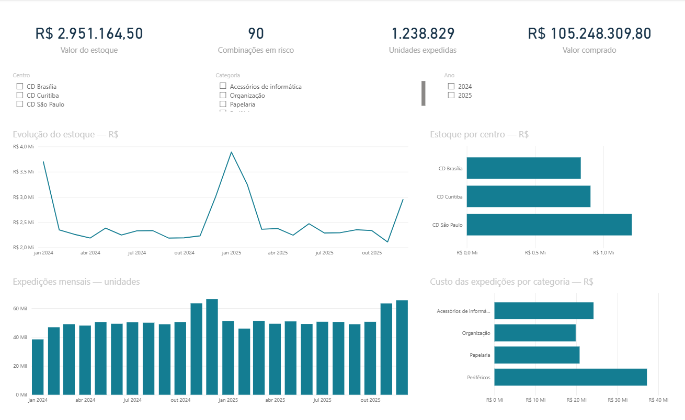
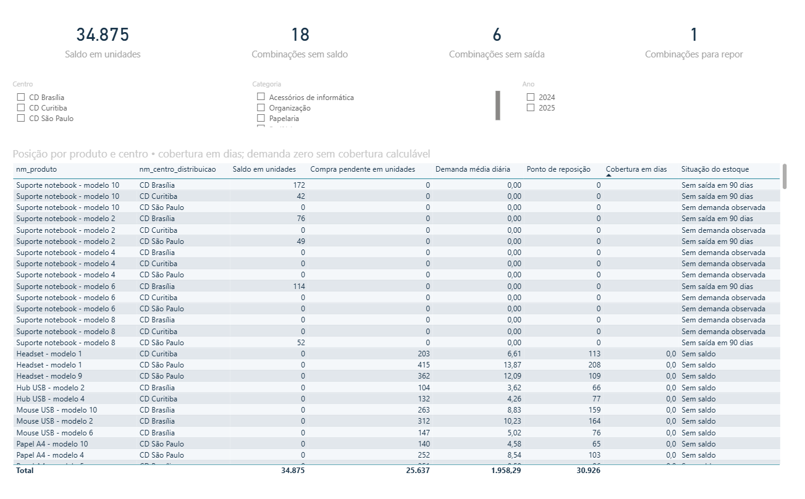
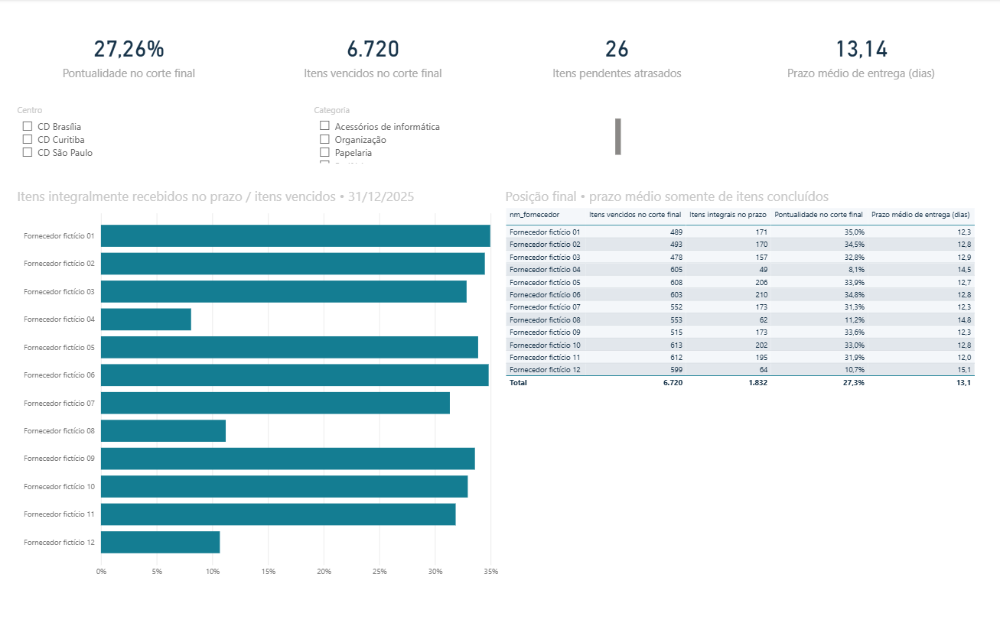
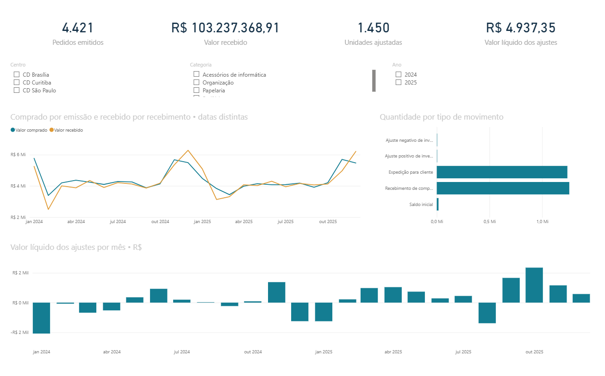

# Supply Chain & Inventory Analytics
Projeto de portfólio da Nexo Distribuidora, com dados integralmente fictícios.

## Comece por aqui
1. Extraia este pacote na pasta do projeto.
2. No terminal, execute: `python configurar_powerbi.py`.
3. Abra `powerbi/SupplyChain.pbip` no Power BI Desktop.
4. Atualize os dados e confira as quatro páginas.
5. Use `docs/04_power_bi.md` para conferir os cartões e concluir a validação visual.

A execução automática já foi realizada neste pacote: banco, SQL, CSV e estrutura
do relatório estão preparados. Não é necessário gerar o banco novamente para
abrir o projeto. O arquivo PBIP não contém um cache de dados; a atualização
inicial no Desktop é necessária.

## Estado real da entrega
- Scripts atuais, incluindo comentários de estudo.
- DDL executada e dados gerados com semente 404.
- 146 testes de restrições e oito testes de regressão aprovados.
- Dez consultas SQL executadas; nove CSV exportados.
- Indicadores de média móvel conferidos nas 219.300 posições.
- Power BI: nove tabelas, 16 relacionamentos, 28 medidas, quatro páginas e 37 visuais.
- 47 arquivos de definição validados.

## Execução completa
Biblioteca padrão do Python 3.10+ para o pipeline principal:

```powershell
python executar_pipeline.py
```

Se a base padrão já existir, ela será reutilizada; os testes e a camada analítica
serão executados. Os CSV, definições do Power BI e relatórios de resultados serão
recriados. Seus arquivos originais em outra pasta não são alterados por isso.

Para reproduzir a geração em outro banco, sem substituir um existente:

```powershell
python executar_pipeline.py --nova-base dados/reproducao.sqlite
```

A opção --nova-base resolve caminhos relativos a partir da pasta atual do
terminal. Execute os comandos na raiz deste projeto.
A auditoria de regressão usa uma cópia em memória da base padrão. A nova base
também passa pela auditoria completa da simulação antes de receber o nome final.

## Arquivos principais

+-----------------------------------------------------------------------+
| Caminho               | Conteúdo                                      |
|-----------------------+-----------------------------------------------|
| modelo.sql            | DDL original                                  |
| gerar_projeto.py      | Dimensões, parâmetros e abertura              |
| simular_operacao.py   | Operação cronológica e auditoria              |
| preparar_analytics.py | Views, dez consultas, validação e exportação  |
| construir_powerbi.py  | Modelo e páginas editáveis                    |
| configurar_powerbi.py | Ajusta o caminho dos CSV ao local de extração |
| executar_pipeline.py  | Coordena as etapas automáticas                |
| sql/                  | Views e consultas analíticas                  |
| dados/                | Banco e relatório de validação                |
| powerbi/              | PBIP, modelo, relatório, dados e medidas      |
| docs/                 | Cenário, regras, dicionário e guia Power BI   |
| resultados/           | Evidências dos testes e resumo visual         |
+-----------------------------------------------------------------------+

## Resultado apurado em 31/12/2025
- Estoque: R$ 2.951.164,50, com 34.875 unidades.
- Compras pendentes: 25.637 unidades.
- 90 combinações produto/centro em risco durante a espera.
- 18 combinações sem saldo e com demanda observada.
- Seis combinações com saldo positivo e sem expedições em 90 dias.
- Pontualidade integral por item: 27,26% (1.832 de 6.720 itens vencidos até o corte).

Esses resultados descrevem a simulação; não são evidência sobre uma empresa real.
Ver `docs/05_resultados_e_validacao.md` para interpretações e limites.

## Dependências opcionais
- `validar_powerbi_schema.py`: biblioteca jsonschema (esquemas já incluídos).
- `gerar_resumo_visual.py`: matplotlib.
Essas dependências não são necessárias para abrir o projeto ou rodar o pipeline.

## Resultados do projeto

Projeto de portfólio desenvolvido com **Python, SQLite, SQL e Power BI**,
utilizando dados simulados da empresa fictícia **Nexo Distribuidora**
para o período de **2024–2025**.

A análise integra compras, recebimentos, movimentações e posições
diárias de estoque de 100 produtos, três centros de distribuição
e 12 fornecedores.

### Principais indicadores

Posição de estoque e avaliação de fornecedores em **31/12/2025**,
considerando todos os centros e categorias.

+-----------------------------------------------------------------+
| Indicador                                     | Resultado       |
|-----------------------------------------------+-----------------|
| Valor do estoque                              | R$ 2.951.164,50 |
| Saldo físico                                  | 34.875 unidades |
| Compras pendentes                             | 25.637 unidades |
| Combinações de produto e centro em risco      | 90              |
| Combinações sem saldo e com demanda observada | 18              |
| Combinações com estoque sem saída em 90 dias  | 6               |
| Pontualidade dos itens de compra              | 27,26%          |
| Itens pendentes atrasados                     | 26              |
+-----------------------------------------------------------------+

### Achados e recomendações

- **Disponibilidade:** priorizar as combinações sem saldo e com demanda
  observada, verificando recebimentos previstos e possíveis transferências.
- **Reposição:** acompanhar compras pendentes nas combinações com cobertura
  inferior ao prazo de reposição. Um pedido emitido ainda precisa chegar
  a tempo para evitar falta.
- **Fornecedores:** investigar os prazos prometidos e realizados dos
  fornecedores com menor pontualidade.
- **Estoque sem saída:** avaliar demanda e alternativas de destinação
  dos saldos sem expedições nos últimos 90 dias.

As recomendações representam oportunidades de atuação identificadas
na simulação. Não foram mensurados ganhos após sua implementação.

## Páginas do Power BI

### 1. Visão executiva

Indicadores gerais, evolução do estoque, expedições e distribuição
do valor por centro e categoria.



### 2. Estoque e reposição

Saldo, compras pendentes, demanda média observada, ponto de reposição,
cobertura e situação de cada combinação de produto e centro.



### 3. Fornecedores

Pontualidade por item de compra, pendências atrasadas e prazo médio
dos itens concluídos, com corte em 31/12/2025.



### 4. Compras e movimentos

Pedidos emitidos, valores comprados e recebidos, movimentações
e ajustes de estoque.



## Resultados e limitações

A documentação detalha as definições dos indicadores, as validações
realizadas, as recomendações e as limitações da análise:

[Resultados e limitações](docs/06_resultados_e_limitacoes.md)

Os dados são sintéticos. A demanda é estimada pelas expedições atendidas,
o que limita a análise durante períodos de indisponibilidade.
O projeto não quantifica vendas perdidas nem comprova relação causal
entre atrasos de fornecedores e faltas de estoque.